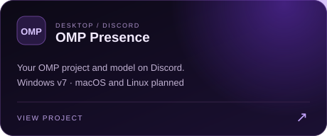
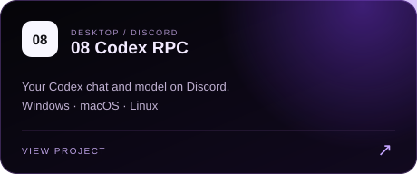

 

<a href="https://github.com/082-0?tab=repositories">Repositories</a> &nbsp;·&nbsp; Discord: <code>082_0</code>

 

I'm just a vibe coder making random shit. Mostly Discord tools, desktop apps, and Minecraft mods.

### My setup

I work with **Codex, OMP, and Tern**. I use that setup to turn an idea into code, test it, and keep improving what I ship. [OMP Presence](https://github.com/082-0/omp-presence) shares my OMP work on Discord. [08 Codex RPC](https://github.com/082-0/08-codex-rpc) does the same for Codex.

### Languages

### Selected work

<table>
  <tr>
    <td width="50%"></td>
    <td width="50%"></td>
  </tr>
  <tr>
    <td width="50%"></td>
    <td width="50%"></td>
  </tr>
  <tr>
    <td width="50%"></td>
    <td width="50%"></td>
  </tr>
</table>

 

**What I work on** &nbsp; `Discord automation` · `Desktop tools` · `Web dashboards` · `Fabric mods`

**Contact** &nbsp; `082_0` on Discord

Bot showcases use demo data. Private bot source and server records stay private.

 

### After hours

