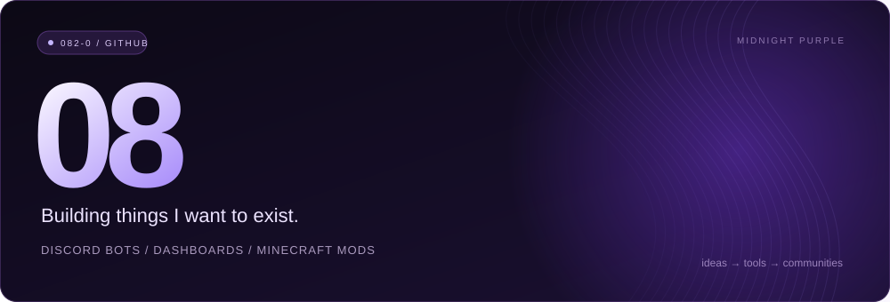
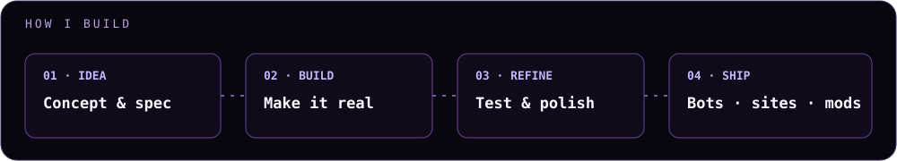
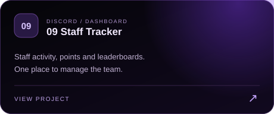
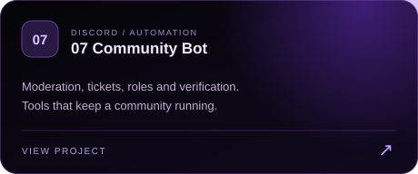
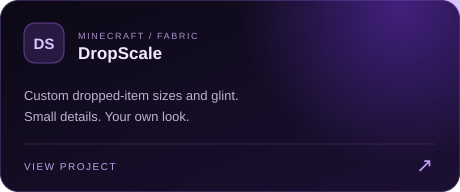
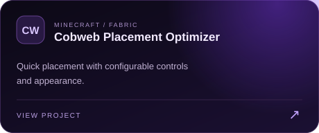

 

<a href="https://github.com/082-0?tab=repositories">Repositories</a> &nbsp;·&nbsp; Discord: <code>082_0</code>

 

I build tools for Discord communities and Minecraft. Bots, dashboards, and mods — from an idea to something people can actually use.

### How I build

### Languages

### Selected work

<table>
  <tr>
    <td width="50%"></td>
    <td width="50%"></td>
  </tr>
  <tr>
    <td width="50%"></td>
    <td width="50%"></td>
  </tr>
</table>

 

**What I work on** &nbsp; `Discord automation` · `Web dashboards` · `Fabric mods` · `Community tools`

**Contact** &nbsp; `082_0` on Discord

Bot showcases use demo data. Private bot source and server records stay private.

 

### After hours

