 

Vibe coder. I build after dark: Discord bots that keep a server together, the dashboards that run them, desktop apps that put my work on Discord, and a couple of Minecraft mods.

**Want one of my bots in your server?** None of them are public. Message **`meatforlove`** on Discord.

### ボット BOTS

<table>
  <tr>
    <td width="50%"></td>
    <td width="50%"></td>
  </tr>
  <tr>
    <td width="50%"></td>
    <td width="50%"></td>
  </tr>
</table>

### アプリ DESKTOP APPS

<table>
  <tr>
    <td width="50%"></td>
    <td width="50%"></td>
  </tr>
</table>

### マイクラ MINECRAFT MODS

<table>
  <tr>
    <td width="50%"></td>
    <td width="50%"></td>
  </tr>
</table>

### 道具 SETUP

I work with **Codex, OMP and Tern**: idea, code, test, ship, repeat. [OMP Presence](https://github.com/082-0/omp-presence) shows my OMP work on Discord; [08 Codex RPC](https://github.com/082-0/08-codex-rpc) does the same for Codex.

`Discord bots` · `Web dashboards` · `Desktop apps` · `Fabric mods`

### 夜の散歩 AFTER HOURS

Bot pages show demo data only. Bot source code and server data stay private.

